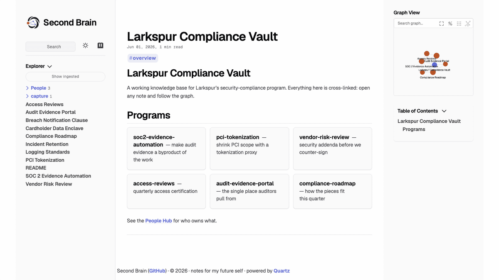

# Vault and Wiki

> Part of the [Second Brain](../README.md) docs — see [docs/README.md](README.md) for the full index.



The [optional wiki view](#wiki-rendered-view-optional) renders your vault as an Obsidian-style site (graph, backlinks, full-text search, People Hub) via Quartz. Above: a synthetic demo vault — regenerate with [`bin/brain-wiki-gif`](../bin/brain-wiki-gif).

> **The wiki is a legacy view, and it has been dormant since R2.** `brain ui` is the primary reading surface: it searches with the same hybrid ranking as `brain search`, and it can edit. Nothing rebuilds the wiki by default any more. `brain-up` no longer builds it, the `com.brain.build` rebuild daemon is retired (the next `brain-install-launchd`, which every `brain-up` runs, boots it out and deletes its plist), and `brain-rebuild`'s default plan keeps the vault mirror current but skips Quartz. Caddy keeps serving the last build. To rebuild on request, run `brain-rebuild --only quartz`, or `BRAIN_WIKI_BUILD=1 brain-up` for a cold start (only when `current/` is missing or unhealthy). The rest of this page describes how the wiki builds when you ask it to. `brain-up` opens it only with `BRAIN_OPEN_BROWSER=1`. To read from a phone, see [Reading your brain from a phone](guides/brain-ui-on-your-phone.md).

## Vault model

Brain has two storage tiers, both searchable through the same hybrid index:

- **Ingested tier** (`kind='ingested'`) — Krisp transcripts, Slack threads, Gmail, raw files. Read-only by convention; the DB is authoritative. Files are mirrored under `_ingested/<source>/` in the vault folder so they show up in the wiki.
- **Vault tier** (`kind='vault'`) — notes you author. The `.md` file on disk is the source of truth; the DB is a derived index that `brain vault sync` rebuilds from the file. Edit in any text editor.

Both tiers live in a single vault folder (default `~/brain-vault/`, override with `BRAIN_VAULT_PATH`). Wiki-links (`[[Title]]`, `[[brain:<id>]]`, `[[krisp:<external_id>]]`) cross both tiers — vault notes can link to ingested artifacts and back.

### One-time vault setup

```bash
# 1. Scaffold the vault folder + templates + _ingested/ subdirs.
brain vault init                         # creates ~/brain-vault/

# 2. Dump the existing DB into the vault as Markdown files. One-shot,
#    safe to re-run, idempotent.
brain vault export --to ~/brain-vault    # produces _ingested/<source>/*.md

# 3. Establish the round-trip baseline so future sync runs are no-ops
#    until you actually edit something.
brain vault sync
```

After this, your DB and vault are in lockstep. Edit any `.md` file in `~/brain-vault/` and the next `brain vault sync` (or the watcher — see below) will re-chunk + re-embed it.

### Authoring commands

```bash
# Create a note from _templates/note.md, opens $EDITOR.
brain note new "person-x conversation"

# Today's daily note at daily/<YYYY>/<YYYY-MM-DD>.md.
brain daily

# Rename a note safely — rewrites every [[old-title]] reference across
# the vault. Atomic snapshot/restore on failure.
brain note rename <id-prefix> "New title"
brain note rename <id-prefix> "New title" --dry-run   # preview the diff

# Edit an existing doc. For vault-tier docs, opens the file in $EDITOR
# directly. For ingested-tier (Krisp/Slack/Gmail), uses the JSON-header
# editor flow.
brain edit <id-prefix>
```

### Link graph

```bash
brain backlinks <id-prefix>              # what links TO this doc
brain links <id-prefix>                  # what this doc links to
brain links <id-prefix> --unresolved     # plus dangling [[refs]]
brain orphans                            # vault notes with no links
brain orphans --all                      # include ingested-tier
brain graph --format json                # full link graph as JSON
brain graph --format dot | dot -Tsvg > graph.svg && open graph.svg
brain graph --format mermaid             # paste into mermaid.live
brain graph --root <id> --depth 2 --format dot | dot -Tsvg > focus.svg
```

### Watcher mode

```bash
brain vault sync --watch
```

Runs as a daemon (Ctrl-C to stop). Filesystem events trigger debounced (500ms) per-file syncs — edit a note, save, and within a beat the chunk + embedding update in the DB. Skips `_templates/`, `_attachments/`, hidden directories. `brain-install-launchd` (which `bin/brain-up` runs) keeps it running under launchd as `com.brain.watcher`, and `brain doctor`'s `vault watcher` line reports when it is not installed (macOS) or not running (elsewhere).

### Vault maintenance

```bash
# Preview or prune vault-tier DB rows whose source files vanished.
brain vault sync --dry-run
brain vault sync --prune

# Remove stale _ingested/ mirror files whose DB rows no longer exist.
brain vault prune-orphans
brain vault prune-orphans --include-stale
brain vault prune-orphans --apply

# Rebuild the name/email directory used by metadata-derived links.
brain vault directory refresh
brain vault directory show
brain vault directory show --source gmail

# Rebuild Gmail/Krisp metadata-derived graph edges and rewrite the
# "Related" fences in affected _ingested/ files.
brain vault relink-derived
```

Use `brain vault directory refresh` after a large Gmail ingest, after changing
Google contacts/calendar access, or after editing any people metadata consumed
by the linker. Use `brain vault relink-derived` when you want the graph and
rendered "Related" sections to reflect the latest Gmail/Krisp corpus. Both
commands are idempotent; missing `gws` degrades to warnings, with Gmail-derived
directory entries still refreshed from already-ingested mail.

**Excluding the corpus owner from derived edges.** By default the
participant-overlap rules (R2 `shared_participant`, R3 `same_day_participant`)
treat every participant as graph-worthy — including yourself, which can make
every meeting/email link to every other doc you're on. Set
`BRAIN_OWNER_PARTICIPANTS` in `.env` to a comma-separated list of identifiers
to strip before the rules evaluate. Both emails AND display names are
accepted, matching is case-insensitive, and entries are trimmed +
lowercased at load time.

For full coverage **list every form your name appears under in your
corpus** — Gmail headers contribute both the email AND a normalized
display-name key for each participant, so listing only the email leaves
the display-name key behind and the rules still match. The recommended
shape is `<Display Name>,<email>[,<other-email>...]`:

```
BRAIN_OWNER_PARTICIPANTS="Pat Morgan,redacted@example.com,redacted@example.com"
```

After changing the value, run `brain vault relink-derived` to rebuild the
derived-links table, then `brain vault sync` to refresh the in-body
"Related" fences. Unset / blank disables the exclusion (existing behavior).

The `brain owner` subcommand group manages this list without hand-editing
`.env`: `brain owner show` prints the active list, `brain owner set
"<csv>"` replaces it, and `brain owner add <id>` / `brain owner remove
<id>` adjust one entry at a time (idempotent, case-insensitive). Each
mutation rewrites `.env` atomically and reminds you to run
`brain vault relink-derived` + `brain vault sync` afterward.

## Wiki (rendered view, optional)

The vault is plain Markdown plus `[[wiki-links]]` plus YAML frontmatter — readable in any editor. When you want a polished wiki view of the vault (graph view, backlinks panel, full-text search, dark mode), `brain vault render` shells out to [Quartz](https://quartz.jzhao.xyz/), a static-site generator built specifically for Obsidian-style vaults. Brain orchestrates Quartz; it doesn't bundle it.

### Quick start (Wiki)

If you want a live wiki view of your vault at `brain.test` (Obsidian-style
graph, backlinks, full-text search, dark mode), wire up Caddy + the Quartz
workspace. This is the procedural "I want it working" path — the
how-it-works details (architecture, atomic build swap, auto-reload
mechanism) live under [Serve locally](#serve-locally) below.

```bash
# 1. Install Caddy (skip if it's already running on your machine).
brew install caddy
brew services start caddy

# 2. Map brain.test to localhost (one-time, system-wide).
echo '127.0.0.1 brain.test' | sudo tee -a /etc/hosts

# 3. Clone Quartz into your vault as .quartz/.
git clone https://github.com/jackyzha0/quartz.git ~/brain-vault/.quartz
cd ~/brain-vault/.quartz
npm install

# 4. Drop in the brain-tuned Quartz config (graph extensions, ignore patterns,
#    reload-signal transformer registration).
cp ~/workspace/second-brain/quartz.config.ts ./quartz.config.ts

# 5. Configure Caddy to serve the live build symlink. Paste the Caddyfile
#    recipe from "Serve locally" below into /opt/homebrew/etc/Caddyfile,
#    replacing /Users/<you>/brain-vault with your actual vault path
#    (Caddy does NOT expand ~). Then reload:
brew services reload caddy

# 6. Build the wiki once. Cold start is ~40s for a ~450-doc vault.
#    (Run `~/workspace/second-brain/bin/brain-up` if `bin/` isn't on your
#    PATH yet — see Running brain from any directory in the configuration
#    docs for the one-time PATH setup.)
BRAIN_WIKI_BUILD=1 brain-up
```

`brain-up` starts the vault sync watcher. Since R2 it builds the wiki only with
`BRAIN_WIKI_BUILD=1`: then it also applies the brain Quartz overlay and runs the
cold-start build (if `current/` is empty or unhealthy). No build watcher runs
any more, so a save in `~/brain-vault/` no longer triggers a rebuild;
`brain-rebuild --only quartz` rebuilds on request, and open tabs auto-reload the
moment that build is swapped in. It opens the wiki in a browser only with
`BRAIN_OPEN_BROWSER=1` (the wiki is a legacy view; read in `brain ui`). See [Daily use —
`bin/` scripts](#daily-use--bin-scripts) for the full daily workflow. The
one-time PATH setup for the `bin/` scripts is
[Running `brain` from any directory](configuration.md#running-brain-from-any-directory)
in the configuration docs.

### One-time setup

Quartz is a Node.js project, so this assumes Node 18+ is on your PATH. `brain doctor` prints a `quartz/npx` line (`OK` / `not installed`) so you can tell at a glance whether you're set up.

**The one-command path is `brain wiki install`** — it does everything below for
you: clones `jackyzha0/quartz` at the pinned commit into `<vault>/.quartz/`,
applies the brain overlay from `quartz_overrides/`, runs `npm install`, and
writes `$BRAIN_HOME/Caddyfile` ready for `caddy run`. (`brain setup --profile
full` runs it as part of first-run provisioning; `--skip-wiki` opts out.)

```bash
brain wiki install --dry-run     # print planned actions, touch nothing
brain wiki install               # clone + overlay + npm install + Caddyfile
brain wiki install --port 9090   # Caddy port written into the Caddyfile (default 8080)
```

Re-running on an existing workspace re-applies the overlay and re-renders the
Caddyfile **without** re-cloning, so it is safe to repeat after a repo update.
`--force` wipes and re-clones (destructive — it `rmtree`s `.quartz/`), and
`--no-npm` skips the install step for offline environments. It does not install
Caddy or npm for you; it prints remediation messages if either is missing.

The manual equivalent, if you would rather drive each step yourself:

```bash
# 1. Clone Quartz into your vault as `.quartz/`. (Quartz isn't published
#    to npm — there's no `npx quartz create`; the canonical install is
#    a git clone of the upstream repo. `brain vault render` looks for
#    the workspace at <vault>/.quartz/ by default; override with
#    --quartz-dir if you want it elsewhere.)
git clone https://github.com/jackyzha0/quartz.git ~/brain-vault/.quartz
cd ~/brain-vault/.quartz
npm install

# 2. Drop in the brain-tuned config. The sample at the brain repo root
#    has the right plugin set for vault notes (graph view, Obsidian
#    flavored markdown, ignore patterns for _templates / _attachments /
#    .quartz / .git).
cp ~/workspace/second-brain/quartz.config.ts ./quartz.config.ts
```

### Render

```bash
brain vault render
# → rendered to ~/brain-vault/.quartz/dist (open …/dist/index.html or serve with `python -m http.server` from there)
```

The output directory is derived from the vault, not from where you happen to be standing, so the site lands in the same place whether you run it from a shell, a script, or a scheduled job.

Flags:

| Flag | Default | Purpose |
|---|---|---|
| `--to PATH` | `<quartz-dir>/dist` (i.e. `<vault>/.quartz/dist`) | Where to write the rendered site. A relative path is resolved against the current directory. The Quartz build **deletes** its output directory before emitting, so render refuses any path that contains the vault, the Quartz workspace, or the current directory — `--to .` included. |
| `--vault PATH` | `cfg.vault_path` | Render a different vault than the configured one. |
| `--quartz-dir PATH` | `<vault>/.quartz` | Point at a Quartz workspace elsewhere on disk. |
| `--no-build` | off | Verify the Quartz workspace is wired up correctly without running the build. |
| `--overlay` / `--no-overlay` | on | Copy `quartz_overrides/` over the workspace before building. See [Customizing the graph](#customizing-the-graph) below. |
| `--print-overlay` | off | Print the overlay plan (file pairs + rename status) and exit without copying or building. Takes precedence over `--overlay/--no-overlay`. |

The build inherits stdout/stderr so you see Quartz's progress live. Builds longer than 5 minutes are killed (assume your config is wedged); if you hit that, check `quartz.config.ts` for a runaway plugin.

### Customizing the graph

Stock Quartz ships a serviceable graph view, but brain extends it with tier coloring (vault vs. ingested), per-source coloring (krisp / slack / gmail / manual), recency-based node sizing, dashed styling for derived edges, and search-driven filter chips. These extensions live under `quartz_overrides/` in this repo and are mirrored into the user's Quartz workspace at build time by `brain vault render`.

**What the overlay does.** Right before invoking `npx quartz build`, the render command runs an *overlay* pass that copies every file under `quartz_overrides/` over the corresponding path in `<vault>/.quartz/`. The directory tree is a 1:1 mirror of its destination — `quartz_overrides/quartz.layout.ts` lands at the workspace root, and `quartz_overrides/quartz/<subdir>/<file>` lands at `<quartz_dir>/quartz/<subdir>/<file>`. One special case: stock Quartz's `quartz/plugins/emitters/contentIndex.tsx` is renamed to `_upstreamContentIndex.tsx` first, so the brain wrapper at `quartz_overrides/quartz/plugins/emitters/contentIndex.ts` can `import { ContentIndex as UpstreamContentIndex } from "./_upstreamContentIndex"`. The rename is idempotent — re-running the overlay on a workspace that already has it does nothing.

**Opt out.** Pass `--no-overlay` to skip the copy entirely and use whatever the workspace currently has. Useful for testing stock Quartz behavior or when you've hand-edited the workspace and don't want it clobbered.

```bash
brain vault render --no-overlay
```

**Inspect.** Pass `--print-overlay` to see the planned rename + copy operations without applying them or building.

```bash
brain vault render --print-overlay
# overlay plan for /Users/you/brain-vault/.quartz:
#   rename: …/contentIndex.tsx → …/_upstreamContentIndex.tsx
#   copy:   …/quartz_overrides/quartz.layout.ts → …/.quartz/quartz.layout.ts
#   …
```

**Upgrading Quartz.** When upstream Quartz cuts a release that touches a file we override, the brain repo's vendored copy needs to be re-rebased on top of the new upstream. The brain delta is anchored by two markers: `// brain:` (value/structural choices on upstream-supported logic) and `// brain-extension:` (keys/types that don't exist in stock Quartz). The combined regex `grep -nE "brain[-:]" <file>` enumerates every change in a file. Each `quartz_overrides/` file's header comment also documents its own upgrade notes inline.

The recipe (run from the brain repo root):

```bash
cd ~/workspace/second-brain     # or wherever you cloned the repo

# 1. Pull the latest upstream copy of the file we override.
curl -L -o /tmp/upstream-Graph.tsx \
  https://raw.githubusercontent.com/jackyzha0/quartz/v4/quartz/components/Graph.tsx

# 2. Diff against the vendored copy to see the brain delta.
diff -u /tmp/upstream-Graph.tsx \
  quartz_overrides/quartz/components/Graph.tsx

# 3. Replace the vendored file with the new upstream and re-apply each
#    `// brain:` / `// brain-extension:` block from the diff.
cp /tmp/upstream-Graph.tsx quartz_overrides/quartz/components/Graph.tsx
# … hand-port the brain markers …

# 4. Smoke-test: brain vault render → open the site, verify the graph
#    still loads and the brain-specific visuals (tier colors, derived
#    edges, recency sizing) all behave.
```

### Serve locally

Brain serves the wiki as a **blue/green static site**: [Caddy](https://caddyserver.com/) serves a `current` symlink under the vault, each build (`brain-rebuild --only quartz`) renders into a fresh sibling directory, and an atomic symlink swap flips traffic to the new build the instant it's ready. Every request between rebuilds hits a complete, self-consistent build — no half-written window, no missing assets, no CSS that doesn't match the HTML. Quartz's own `--serve` dev server is no longer used.

```
~/brain-vault/.quartz/
  builds/
    20260501-153912-ab12cd/    ← one dir per build
    20260501-154430-ef34gh/
    20260501-155102-ij56kl/    ← active
  current → builds/20260501-155102-ij56kl/   ← Caddy serves this
```

**Caddyfile.** Paste the recipe below into `/opt/homebrew/etc/Caddyfile` (system-wide, absolute paths only — Caddy does *not* expand `~`). Replace `/Users/<you>/brain-vault` with your actual vault path:

```caddy
http://brain.test, http://localhost:8080 {
    root * /Users/<you>/brain-vault/.quartz/current
    file_server
    @build_id path /.build-id
    header @build_id Cache-Control "max-age=2, must-revalidate"
    try_files {path} {path}/ {path}.html /404.html
    encode gzip
}
```

Then `brew services reload caddy`. `localhost:8080` stays as a backwards-compat alias for anything that hardcodes the port. The `try_files` chain handles Quartz's three slug shapes (`/foo`, `/foo/`, `/foo.html`) and falls back to Quartz's own `404.html`. The `Cache-Control` override on `/.build-id` is what lets the auto-reload poller actually see new build IDs instead of a stale cached one.

**`/etc/hosts`.** One-time entry so `brain.test` resolves locally:

```bash
echo '127.0.0.1 brain.test' | sudo tee -a /etc/hosts
```

**Auto-reload.** When a build swaps `current/` to a new build, every open tab reloads within ~1-2 seconds. The mechanism: `brain-rebuild --only quartz` (and `BRAIN_WIKI_BUILD=1 brain-up`'s cold start) sets `BRAIN_WIKI_RELOAD=1` for the build, which makes the brain Quartz overlay's `Plugin.ReloadSignal()` transformer inject a `<script src="/static/reload.js" defer>` into every page. That script polls `/.build-id` every 1 second while the tab is foregrounded, sends `If-None-Match` after the first ETag-bearing response so unchanged builds return `304 Not Modified`, pauses while the tab is backgrounded (so an idle tab in the background doesn't generate traffic), and calls `location.reload()` when the build ID changes. `brain vault render` (the one-shot prod build path) leaves `BRAIN_WIKI_RELOAD` unset, so production builds ship without the polling script — only the dev daily-use flow gates it on.

**First-build cost.** Cold start (`BRAIN_WIKI_BUILD=1 brain-up` against an empty `.quartz/current`) takes ~40s for a ~450-doc vault — the user sees a "first build, ~40s" message in the foreground before the script returns. Full rebuilds (rename, frontmatter change, structural edit) are also ~40s, but they happen entirely in the background under `builds/<ts>-<hash>/`; open tabs keep seeing the previous build right up to the atomic swap. Until R2 the build watcher also coalesced rapid edits with a 1.5s debounce, so a flurry of saves produced one rebuild rather than one per save. Old build dirs are GC'd after each swap (default keep=3, tunable via `BRAIN_WIKI_KEEP_BUILDS`); the build that `current` points at is never deleted, even if it's beyond the keep window.

**Per-file fastpath (trivial edits).** *Dormant since R2: the fastpath lives in the retired build watcher.* When you edit one Markdown file's body without changing structural fields (title, tags, slug, etc.), the watcher routes the edit through a per-file partial emit instead of a full rebuild. Warm fastpath builds land in ~700ms-1.8s on a ~1100-doc vault; combined with the 1s reload poll, the total edit-to-UI latency is ~2 seconds. The mechanism: a full build writes a `manifest.json` + `contentmap.json` envelope under `<vault>/.quartz/.cache/fastpath/` keyed by canonical structural fingerprints; `brain.wiki.edit_classifier` recomputes the fingerprint after each edit and routes TRIVIAL edits to a Quartz `build-partial` subcommand that re-emits only the changed file's HTML (cross-file emitters like backlinks/graph see a synthesized full corpus so they don't break). Anything non-trivial (rename, tag change, slug collision, manifest miss) falls back to the full build path. Set `BRAIN_FASTPATH_ENABLED=false` to disable the fastpath if you ever need to.

Backlinks, graph view, and full-text search all work out of the box — that's Quartz's job, not brain's.

### Daily use — `bin/` scripts

Four convenience scripts under `bin/` cover the daily flow. They assume `bin/` is on your PATH — see [Running `brain` from any directory](configuration.md#running-brain-from-any-directory) in the configuration docs for the one-time setup.

```bash
brain-up       # start the vault sync watcher (launchd). With BRAIN_WIKI_BUILD=1
               # also apply the Quartz overlay + cold-start build (if needed).
               # Opens the wiki only with BRAIN_OPEN_BROWSER=1. Idempotent.
brain-down     # stop the sync watcher (and any legacy build watcher). Caddy is
               # left running so brain.test keeps serving the last good build.
brain-rebuild  # full-corpus rebuild: embeddings → summaries → search →
               # graph → graph-weights → communities → connect → mirror
               # (vault export + sync-summaries + prune-orphans). The Quartz
               # build is the opt-in `quartz` stage, run only when named.
               # Common flags:
               #   --only STAGES   comma-separated stage ids to run
               #                   (--only quartz rebuilds the dormant wiki)
               #   --skip STAGES   comma-separated stage ids to skip
               #   --dry-run       print the plan; run nothing, take no lock
               #   --force         bypass the in-flight-ingest guard
               #   --clean-cache   wipe <vault>/.quartz/.cache/parser/ before
               #                   the quartz build; requires --only quartz
               # --wiki-only was removed at R2 (it exits 2): use --only mirror
               # or --only quartz.
brain-status   # show watcher state (the build watcher reads "dormant"), the
               # active build dir, the build-id pinned by current/, and
               # whether the wiki URL is reachable.
```

`brain-up` is idempotent: re-running it re-uses the running sync watcher, and with `BRAIN_WIKI_BUILD=1` it skips the cold-start build when `current/` is healthy. `brain-down` deliberately leaves Caddy alone — the previous build keeps serving while you iterate, and `brain.test` survives `brain-down && brain-up` cleanly. The blue/green swap means open tabs survive every rebuild — no broken assets, no half-written CSS, no flicker.

Env overrides:

| Variable | Default | Purpose |
|---|---|---|
| `BRAIN_VAULT_PATH` | `~/brain-vault` | Vault directory the watchers + builds operate against. |
| `BRAIN_WIKI_PORT` | `8080` | Port the wiki URL uses: `brain-up` opens it (only with `BRAIN_OPEN_BROWSER=1`), `brain-status` curls it. Caddy must be configured to listen on it (see [Serve locally](#serve-locally)). |
| `BRAIN_OPEN_BROWSER` | `0` | Set `1` to open the wiki after `brain-up`. Opt-in since the wiki became a legacy view; `brain ui` is the reading surface. |
| `BRAIN_WIKI_BUILD` | `0` | Set `1` to have `brain-up` apply the Quartz overlay and run the cold-start wiki build. Off since R2, when the wiki went dormant; `brain-rebuild --only quartz` rebuilds it on request. |
| `BRAIN_WIKI_KEEP_BUILDS` | `3` | How many old build dirs under `builds/` to retain after each swap. Lets you `git diff`-style inspect prior builds. |
| `BRAIN_NO_OVERLAY` | `0` | Set `1` to skip the Quartz overlay step at startup. Useful when iterating on stock Quartz behavior. |
| `BRAIN_NO_BUILD_WATCHER` | `0` | Set `1` to skip launchd supervision during `brain-up` (used by the bin-script tests). The name predates R2; there is no build watcher left to skip. |
| `BRAIN_FASTPATH_ENABLED` | `true` | Build-watcher only, so dormant since R2. Set `false`/`0`/`no` to disable the per-file partial-emit fastpath and force every vault edit through a full rebuild. See [Serve locally → Per-file fastpath](#serve-locally) for the trade-off. |
| `BRAIN_PY` | (unset) | Test/CI knob — overrides the Python interpreter `bin/brain-up` invokes for the watcher + build subprocesses. (`brain-rebuild` is now a Python console-script entry point that uses its venv's `sys.executable` directly; `BRAIN_PY` does not affect it.) Defaults to `<repo>/.venv/bin/python`. |

PIDs are tracked at `$BRAIN_HOME/run/brain-{watch,build}.pid` (moved off `/tmp` in `f5e551a` because macOS's `tmp_cleaner` reaped them and `brain-status` then falsely reported the daemon as stopped; override via `BRAIN_WATCH_PID` / `BRAIN_BUILD_PID`). Logs still default to `/tmp/brain-{watch,build}.log` (override `BRAIN_WATCH_LOG` / `BRAIN_BUILD_LOG`). The legacy `$BRAIN_HOME/run/brain-wiki.pid` from the old `quartz --serve` setup is still cleaned up by `brain-down` for backward compat — fresh installs won't see it.

### Deploy (optional)

`dist/` is plain HTML/CSS/JS — drop it on GitHub Pages, Netlify, S3, Cloudflare Pages, or anywhere else. Quartz's docs cover the deployment recipes; brain doesn't take a position. Note that the default config at the brain repo root has analytics turned off and `baseUrl: "localhost:8080"`; flip both before publishing the site somewhere public.

### When Quartz isn't a fit

If Quartz drifts incompatibly, gets archived, or you just want a different look: the vault format (Markdown + frontmatter + `[[wiki-links]]`) is generic enough that any Obsidian-aware renderer (MkDocs Material with the right plugins, Hugo with an Obsidian theme, your own exporter) can replace it without touching the vault folder. Brain doesn't lock you in.
